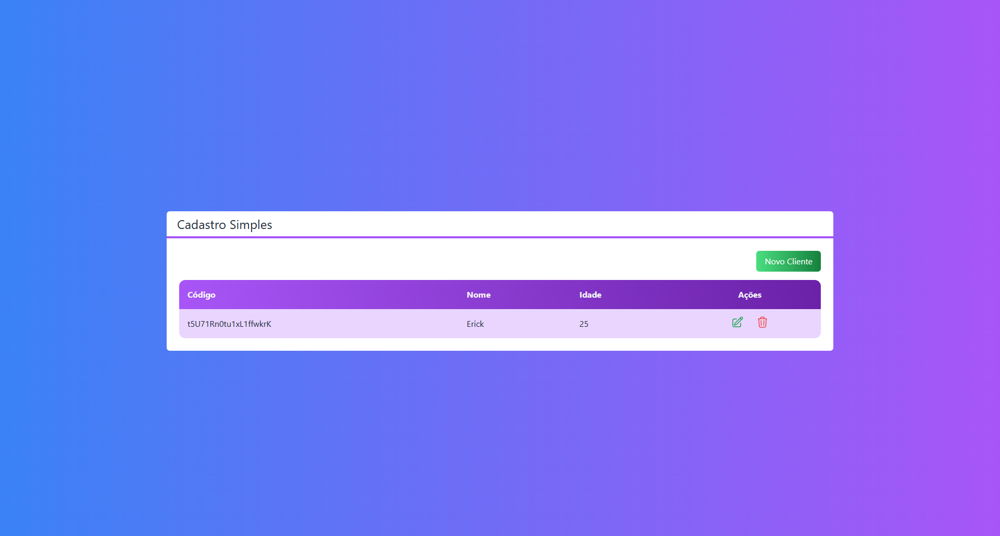
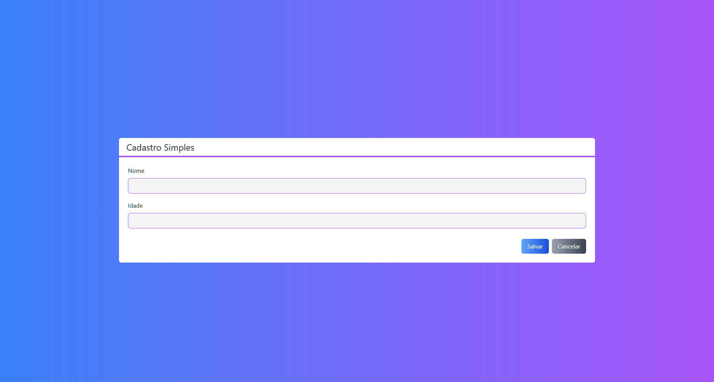
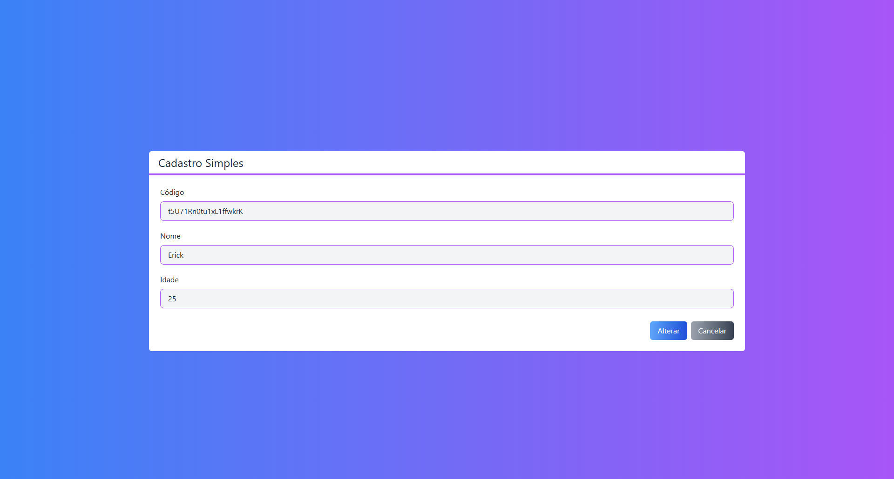

# Projeto Next.js CRUD (Cadastro Simples)

Aplicação full-stack simplificada desenvolvida em **Next.js** para gerenciamento de clientes com operações de **CRUD** e banco de dados na nuvem.

<p align="left">
  
  
  
  
  
</p>

---

## 🛠️ Tecnologias Utilizadas

O projeto foi construído utilizando a seguinte stack tecnológica:

* **[Next.js](https://nextjs.org/)** (versão 14) - Framework React focado em desempenho e renderização híbrida.
* **[TypeScript](https://www.typescriptlang.org/)** - Superset JavaScript para garantir tipagem estrita e segurança no código.
* **[Tailwind CSS](https://tailwindcss.com/)** - Framework CSS utilitário para uma estilização moderna e responsiva.
* **[Firebase / Cloud Firestore](https://firebase.google.com/)** - Banco de dados NoSQL em tempo real para persistência dos dados dos clientes.
* **Git & GitHub** - Controle de versão e gestão do repositório.

---

## 📸 Demonstração da Aplicação

### 1. Tela Inicial (Listagem de Clientes)
Apresenta a tabela com os registos existentes obtidos em tempo real do Cloud Firestore, permitindo acessar as ações de edição e exclusão, além do botão para criar um novo registo.


### 2. Tela de Cadastro (Novo Cliente)
Interface de formulário limpa e intuitiva para inserção de novos dados (Nome e Idade).


### 3. Tela de Alteração de Registo
Permite editar as informações de um cliente já existente, identificando o código único do registo.


---

## 🚀 Como Executar o Projeto Localmente

Certifica-te de que você tem o **Node.js** instalado na sua máquina.

1. **Clona o repositório:**
   ```bash
   git clone https://github.com/Erick-de-Paiva/projeto-next-crud.git
   ```

2. **Acesse a pasta do projeto:**
   ```bash
   cd projeto-next-crud
   ```

3. **Instale as dependências:**
   ```bash
   npm install
   ```

4. **Configure as variáveis de ambiente:**
   Crie um arquivo `.env.local` na raiz do projeto com as credenciais da sua aplicação Firebase.

5. **Execute o servidor de desenvolvimento:**
   ```bash
   npm run dev
   ```

6. **Acesse no navegador:**
   Abra o seu navegador em `http://localhost:3000`.

---

## 📦 Build de Produção

Para gerar a versão otimizada de produção do projeto, execute:

```bash
npm run build
```
